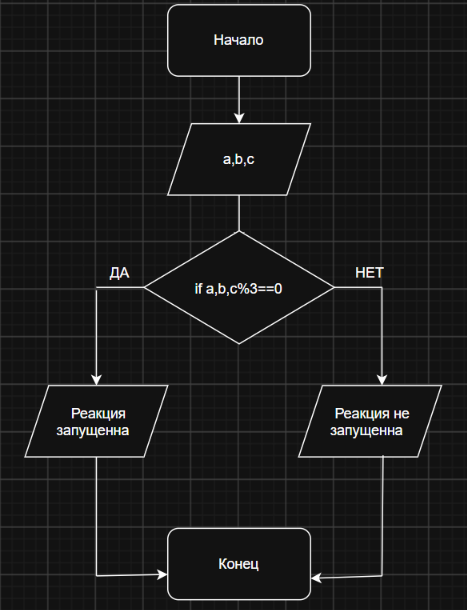

###Домашняя работа             
###Варинат 12
Условие: Чтобы получить философский камень, алхимик должен смешать три ингридиента в строгой пропорции. Реакция запуститься, если масса каждого ингридиента(a,b,c) кратна трем. Запишите условие успешного запуска реакции
#
#Вывод: В ходе выполнения программы я закрепила навыки ввода данных с помощью scanf, вывода сообщений с помощью puts и printf, а также использования логических операторов и операции нахождения остатка от деления %. В результате программа проверяет, кратны ли массы всех трёх ингредиентов числу 3, и определяет, запустится ли реакция для получения философского камня.
